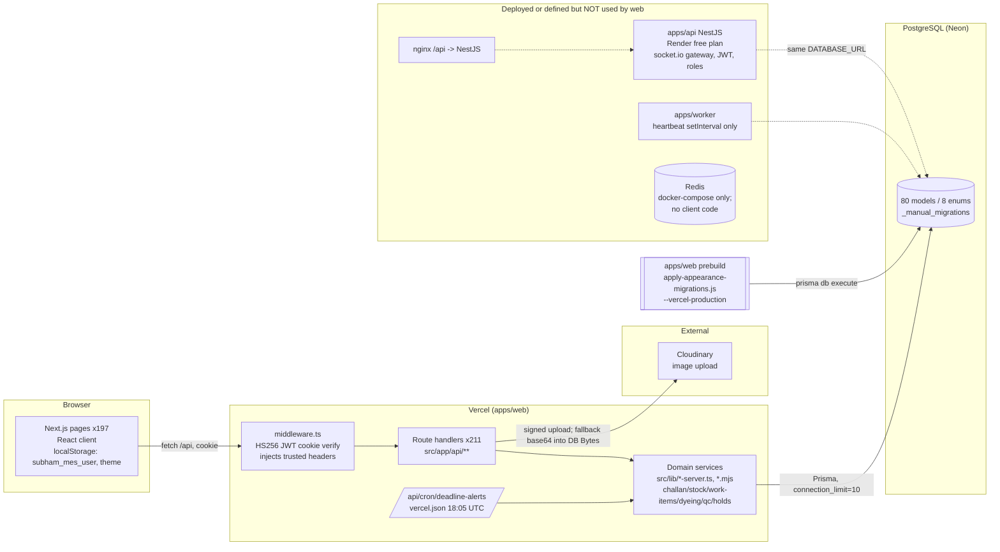

# 01 — Architecture & Database Audit (Stage 1, §3.1 + §3.2)

Branch audited: `fix/mes-production-readiness` (= origin/main, HEAD 349af5a). Read-only audit: no source edits, no DB connection, no dev server.

## Summary

- **The live system is a single Next.js 15 app (`apps/web`) that talks directly to PostgreSQL through Prisma.** All 211 route handlers and 197 pages are in it. The browser always calls same-origin `/api` (`apps/web/src/lib/api.ts:2`).
- **`apps/api` (NestJS) is a parallel, stale backend.** The web app never calls it, but `render.yaml:1-24` still deploys it. It holds a second implementation of challans, inventory, rework and auth, and it depends on roles that the last migration deletes.
- **`apps/worker` is a placeholder.** It only logs counts once a minute (`apps/worker/src/main.ts:8-20`). There is no queue, Redis or WebSocket use in the live path. The only background job is one Vercel cron.
- **The schema has no migration history (no `prisma/migrations`).** The base tables come from `prisma db push` (`packages/database/package.json:9`). Every change after that is a hand-written SQL file run by a custom runner during the Vercel production build. One migration file is orphaned and a legacy `prisma/sql` folder has drifted.
- **Quantities are almost all `Float` (108 fields) against 8 `Decimal`.** Units are free-text strings, statuses are free-text strings (21 `status String` fields), and hot challan columns have no indexes.
- **Historical records can be hard-deleted, including their audit trail.** Single-challan DELETE and program DELETE (the latter open to the PROGRAMMING department) remove production transactions, ledger rows and the AuditLog rows that describe them. The generic challan PATCH changes status with no transition check and no event or audit row.

## Architecture

### Diagram

### Component table

| Component | Status | Evidence | Notes |
|---|---|---|---|
| apps/web (Next 15, app router) | **Live, sole system of record** | `apps/web/package.json:7-10`; 211 `route.ts`, 197 `page.tsx` | UI, API, domain logic and the cron all live here. |
| Web API client | Same-origin only | `apps/web/src/lib/api.ts:1-5` | `NEXT_PUBLIC_API_URL` is used only for server-side calls when `VERCEL_URL` is unset. Nothing references port 3001. |
| Auth | Stateless HS256 JWT in an httpOnly cookie (12 h default); the cookie or `Authorization: Bearer` is accepted | `apps/web/src/middleware.ts:37-77`; `lib/auth/session-token.ts:9-13,36-40,113-115` | Each request re-reads the user from the DB and rejects inactive users (`lib/auth/require-user.ts:56-67`). The middleware sets the admin gate from the claims (`middleware.ts:69`). |
| Authorization | By department (`DEPARTMENT_ACCESS`) | `lib/auth/department-access.ts:7,116-121` | Roles were removed by migration `20261102_remove_roles.sql:9-11`, but the role tables, role claims and role code paths remain. |
| Domain services | `apps/web/src/lib/*` (about 70 files) | e.g. `lib/work-items-server.ts`, `lib/challan-edit-server.ts` | Challan creation is implemented in 7 places in web (`app/api/challans/route.ts:503`, `qc1/challans/[id]/inspect/route.ts:364,420`, `lib/dyeing-qc-issue.ts:139`, `lib/qc1-decision-server.ts:222`, `lib/recutting-server.ts:479`, `lib/work-items-server.ts:1093`) and in 2 more in NestJS. |
| apps/api (NestJS 11) | **Dormant duplicate**, still deployed | `render.yaml:1-24`; `apps/api/src/main.ts:29`; `modules/challans/challans.service.ts:148` | Has its own JWT issuer, a socket.io gateway (`modules/floorboard/floorboard.gateway.ts:12`) and `@Roles` guards (9 uses), all on an empty Role table. |
| apps/worker | Stub | `apps/worker/src/main.ts:8-20` | No queue. Never deployed (absent from `render.yaml` and docker-compose). |
| Redis / WebSockets / SSE | Not used by the live app | docker-compose `redis` service; no `ioredis`/`bullmq`/`EventSource` in `apps/web/src` | The floor boards poll over HTTP. |
| Cron | Vercel cron, guarded by `CRON_SECRET` bearer or an admin session | `apps/web/vercel.json:2-7`; `app/api/cron/deadline-alerts/route.ts:24-30` | |
| Shared packages | `@shubham/types`, `validation` and `config` are **not imported by web** (0 files); `database` is imported by 88 files | grep counts | Status and department vocabularies are redefined in web (`lib/departments.ts:15+`). There is **no zod validation in any web route** (0 imports), even though zod is a dependency. |
| File storage | Cloudinary, else raw bytes in Postgres | `lib/cloudinary.ts:3-33`; `app/api/upload/route.ts:8,55`; 8 `Bytes` columns (`schema.prisma:645,668,1839,1878,1983,2006,2048`) | Workbooks, photos and branding images are stored inside the DB. |
| Deployment | Vercel (web); Render (NestJS); Docker/nginx (stale) | `render.yaml`; `infrastructure/nginx/nginx.conf:33-51`; `infrastructure/docker/docker-compose.yml:36-71` | nginx routes **`/api/` to NestJS**, which would shadow every Next route handler in a Docker deployment. There is **no `.github/workflows`, so no CI**. |
| Migrations | Custom runner during the Vercel prod build | `apps/web/package.json:8`; `scripts/apply-appearance-migrations.js:68-71,123-147` | The script comment says predev/prestart (`:5`), but neither hook exists in `apps/web/package.json`. Only `prebuild` with `--vercel-production` runs it. |
| Logging/monitoring | `console.*` only; a `/api/health` endpoint with a schema-drift check | `app/api/health/route.ts:8-20`; `lib/schema-check.ts:31-60` | No APM, error tracker or structured logs. |

### Duplicate responsibilities and conflicting sources of truth

1. **Two backends on one DB.** NestJS still writes `InventoryStock` and `ReworkTransaction`, which no web code writes (grep: web 0 / api 1 each). It also writes `Challan` (`challans.service.ts:148`, `finalcheck.service.ts:307`) using older numbering and workflow rules. If anything calls the Render service, it bypasses the web invariants such as stock sync, per-department numbering and holds.
2. **Two auth systems.** NestJS signs `{sub, username, role, roles, departmentCode}` with `JWT_SECRET` (`apps/api/src/modules/auth/auth.service.ts:62-70`). Web accepts `AUTH_SECRET || JWT_SECRET` and a Bearer header (`session-token.ts:37,113-115`). If the two secrets are shared, a NestJS token passes signature verification in web even though it lacks `dept`. I did not verify the runtime behaviour.
3. **Two stock ledgers with different precision.** `StockLedgerEntry` stores `quantity Float` (`schema.prisma:968`) and `FabricStockLedger` stores `quantity Decimal(10,2)` (`schema.prisma:1493`). There are also three roll models: `FabricRoll` (`:990`), `FabricStoreRoll` (`:1365`) and `FabricBatch` (`:1318`). `InventoryStock` (`:917`) is a third balance table that web never maintains.
4. **Roles and departments.** Roles were deleted (`20261102_remove_roles.sql:9-11`), but `isAdminClaims` still checks role strings (`session-token.ts:119-127`), `requireDepartment` still passes `roles` (`department-access.ts:117-120`), and `Role`, `Permission`, `RolePermission` and `UserRole` remain in the schema (`schema.prisma:84-137`).
5. **Department and status vocabularies** are kept in `packages/types` enums (`packages/types/src/index.ts:35,80`), in `lib/departments.ts` (15 codes) and in the `Department` table. `Challan.status` is a free string (`schema.prisma:727`).
6. **localStorage holds only the UI profile.** It is used in 32 page files to drive client-side UI (`lib/api.ts:19-22`). The server never trusts it, so the DB and cookie remain authoritative. It is still a stale-UI risk after a department change, until the cached profile refreshes.
7. **The generated Prisma client is committed twice:** 28 files each in `packages/database/src/generated/client` and `apps/web/src/generated/client`, including a 15 MB+ engine `.so`. After normalisation each copy matches `schema.prisma` (only index order differs). The working tree has uncommitted regenerated copies.

## Database

Datasource: `postgresql` (`schema.prisma:10-11`). There are 80 models and 8 enums. Quantity-type counts: `Float` 108, `Decimal` 8, `Int` 46 fields. Relation `onDelete` settings: 34 Cascade, 8 SetNull, 3 Restrict. There are 129 `@@index`, 62 unique constraints, and **no soft-delete column on any model**. All PKs are `String @default(uuid())`.

Schema vs manual migrations spot-check: every `ADD COLUMN` and `CREATE TABLE` in `manual-migrations/*.sql` has a matching field or model in `schema.prisma`. I checked this automatically, with 0 missing. Examples checked by hand: `ChallanItem.width`/`unitQuantity`/`programId`/`sourceChallanItemId`, `ShrinkageRecord`, `DepartmentHold`, `FabricPhoto`, and `Challan @@unique([fromDepartment, challanNumber])` (`20261028_challan_number_per_department.sql:9-16` vs `schema.prisma:779-780`).

### Findings

| ID | Sev | Area | Evidence | Problem | Impact | Recommended fix |
|---|---|---|---|---|---|---|
| DB-01 | **Critical** | Audit / immutability | `apps/web/src/app/api/challans/[id]/route.ts:86-191` | Admin DELETE hard-deletes the challan and, with it, its `ProductionTransaction` (:127), QC (:145), bundles (:165), items (:171), `ChallanEvent` (:174) **and its `AuditLog` rows (:179-186)**. It is not gated by `destructiveAdminActionsDisabled()`, unlike `admin/clear-all-data/route.ts:12`. | Production and stock history can vanish with no trace. Child challans are silently orphaned (:108). | Replace with cancel or void (status plus reason plus event). Never delete AuditLog rows. If deletion is kept, add the destructive gate and write a tombstone audit row. |
| DB-02 | **Critical** | Audit / authz | `apps/web/src/app/api/programs/[id]/route.ts:67-71,130,181,193,206,270-280` | Program DELETE is allowed for the **PROGRAMMING department** (not admin), with no status guard. It deletes every challan, production transaction and `StockLedgerEntry` of the program, plus its AuditLog rows. | One user can erase a production sheet's entire history, including ledger movements. | Allow deletion only for DRAFT sheets with no challans. Otherwise cancel. Restrict to admin and keep the audit trail. |
| DB-03 | High | Audit / state machine | `apps/web/src/app/api/challans/[id]/route.ts:209-260,314` | PATCH accepts any `status` string (no allowed-transition list in the file or in `canUpdateChallan`, `department-access.ts:127-134`). It updates without an optimistic-lock check and writes no `ChallanEvent` or `AuditLog` (neither `create` appears in the file). Compare the edit path `lib/challan-edit-server.ts:232-249`, which has both. | Untracked status jumps; lost updates under concurrency. | Centralise transitions in a single state-machine module, require `updatedAt` matching, and always write a ChallanEvent. |
| DB-04 | High | Admin bulk deletes | `app/api/admin/challans/delete-all/route.ts:16-66`, `admin/programs/delete-all/route.ts:21-88` | These wipe challans, ledgers and AuditLog. They require admin but **not** `destructiveAdminActionsDisabled()` (only `clear-all-data` uses it). | Production data can be wiped by a single admin click. | Apply the env gate to all bulk deletes, or remove the endpoints from production builds. |
| DB-05 | High | Precision | `schema.prisma` 108 `Float` fields, e.g. `ChallanItem.quantity:802`, `ProductionTransaction.*Quantity:875-880`, `StockLedgerEntry.quantity/balanceAfter:968,977`, `DepartmentWorkItem.*Quantity` (~`:1632-1638`), `DepartmentHold:2089-2092` | Metres and pieces are stored as IEEE doubles. Only the Fabric Store models use `Decimal(10,2)` (`:1329,1372,1417,1436,1493`). | Rounding drift in balances (sum of Float lines compared with a Decimal ledger), and equality checks on "fully forwarded" can fail. | Migrate quantity columns to `Decimal(12,3)` and use Prisma `Decimal` in services. |
| DB-06 | High | Indexes | `schema.prisma:712-781` (Challan), `:783-830` (ChallanItem), `:862-888` (ProductionTransaction), `:890-905` (QualityInspection) | Challan has indexes only on `(fromDepartment, challanNumber)` and `challanNumber`. There is **no index on `toDepartment`, `status`, `programId`, `parentChallanId` or `createdAt`**, although inbox queries filter `toDepartment` (24 API files). ChallanItem has **no `challanId` index** (FK with cascade). ProductionTransaction and QualityInspection have **no indexes at all**. | Sequential scans as data grows; slow cascades and deletes. | Add `@@index([toDepartment, status])`, `[programId]`, `[parentChallanId]`, `[createdAt]` on Challan; `[challanId]` on ChallanItem; `[challanId]` and `[programId]` on ProductionTransaction and QualityInspection. |
| DB-07 | High | Migration governance | `packages/database/package.json:9`; no `prisma/migrations` dir; `scripts/apply-appearance-migrations.js:27-62,130-147` | The baseline schema exists only through `db push`. Later changes are hand-written SQL run by `prisma db execute` during the **Vercel production build** (`apps/web/package.json:8`), against the shared DB, before deploy, with no rollback. A changed file is re-applied whenever its checksum changes (`:123`), and the list is out of date order (`20261101_hold_details` runs before `20261030`/`20261031`, `:55-57`). | A fresh environment cannot be rebuilt reproducibly. A bad SQL file mutates production mid-build, and editing an old file silently re-runs it. | Adopt `prisma migrate` with a baseline (`migrate diff` → `0_init`, `migrate resolve --applied`). Run `migrate deploy` in a gated release step, not in `prebuild`. Make applied migrations immutable. |
| DB-08 | Medium | Drift | `manual-migrations/20261026_fabric_stock_import.sql` (not in the runner list `apply-appearance-migrations.js:27-62`); `schema.prisma:1833,1869` | The `FabricStockImport` and `FabricStockImportDocument` tables exist in the schema but are created only by the orphaned file. | A new DB lacks the tables, and `/api/health` reports degraded (`lib/schema-check.ts:44-60`). | Add the file to the list or delete the models. |
| DB-09 | Medium | Drift | `packages/database/prisma/sql/2026-10-24-deadline-alerts.sql:2`, `2026-10-24-manual-challan-stock-dyeing.sql:2-3` | Legacy SQL adds `Challan.deliveryDate` and `ChallanItem.requiredDyeColor`/`requiredDyeQuantity`, which **are not in schema.prisma** (the schema uses `requiredColour`/`requiredQuantity`, `:791-792`). | If these were ever applied, a later `db push` drops the columns and their data, or prompts for it. | Delete the folder after checking the live DB. Never use `db push` against production. |
| DB-10 | Medium | UOM modelling | `ChallanItem.unitType/uom/averageUnit/unitQuantityUom:797,805,807,809`; `Challan.fabricUnit/defectiveUnit:751-753`; 23 unit `String` columns; no CHECK constraints in any migration | Units are free text such as MTR, PCS or MIXED. `Challan.fabricIn/fabricOut` become null for MIXED (`challan-edit-server.ts:229`), and `ShrinkageRecord.remainingQty` is null when units differ (`:847`). | Mixed-unit arithmetic errors; invalid unit values can be stored. | Add a `Uom` enum (MTR, PCS, KG) or a CHECK constraint, and keep header totals per unit instead of nulling them. |
| DB-11 | Medium | Status modelling | 21 `status String` fields, e.g. `Challan:727`, `Program:418`, `QualityInspection:899` | There are no enums or CHECK constraints. The types enum (`packages/types/src/index.ts:80-95`) is unused by web. | Typos or invalid statuses persist and dashboards miscount. | Use a Postgres enum or CHECK constraint per status column, driven by one shared constant. |
| DB-12 | Medium | Cascades | `ChallanItem→Challan Cascade:786`; `ChallanEvent→Challan Cascade:940`; `ShrinkageRecord Cascade:838-840`; `ProductionTransaction→Challan` (no onDelete, so Restrict):867 | Cascades on transactional children make hard deletes easy. Event history cascades away with its challan. | History loss (see DB-01). | Use `Restrict` on events, items and ledgers. |
| DB-13 | Medium | Attribution | `apps/web/src/lib/auth/delete-user.ts:26-56` | Deleting a user rewrites **every FK column referencing User**, including `AuditLog.actorId`, `ChallanEvent.actorId` and ledger actors, to a shared "Deleted User". | The record of who performed historical actions is destroyed. | Deactivate users (`isActive=false`) instead of deleting them. |
| DB-14 | Medium | Dead / duplicate models | `InventoryStock:917`, `ReworkTransaction:1164`, `FabricRoll:990` vs `FabricStoreRoll:1365`, `Role/Permission/...:84-137` | Models are written only by dormant NestJS or emptied by migration. | Confusion over which table is authoritative, and dead joins. | Retire them or document them as deprecated, and drop them in a governed migration. |
| DB-15 | Medium | Missing FKs | `ProductionTransaction.departmentCode:868`, `QualityInspection.programId:894` (no relation), `StockLedgerEntry.referenceId:972`, `InventoryStock.programId/lastChallanId:925-926`, `ChallanItem.sourceLotId/sourceRollId/sourceBundleId:813-815` | Plain strings with no referential integrity. | Orphan references; traceability joins break. | Add FKs where the target is fixed. Keep polymorphic references but index them. |
| DB-16 | Low | Blob storage in DB | 8 `Bytes` columns (`schema.prisma:645,668,1839,1878,1983,2006,2048`); `app/api/upload/route.ts:55` base64 fallback | Images and workbooks are stored in Postgres. | DB bloat, slow backups and higher Neon cost. | Move to object storage (Cloudinary or S3) and store only the URL and hash. |
| DB-17 | Low | Generated client in VCS | `git ls-files` shows 28 files each under `packages/database/src/generated/client` and `apps/web/src/generated/client`; `.gitignore` does not exclude them | Two committed copies, plus engine binaries. | Merge noise; a stale client can ship if `generate` silently fails (`packages/database/package.json:8` swallows errors). | Gitignore the generated client, run `prisma generate` in the build, and fail on error. |
| DB-18 | Low | Docs drift | `scripts/apply-appearance-migrations.js:5-7` vs `apps/web/package.json:7-10` | The comment claims predev/prestart hooks that do not exist. | Operators may misunderstand when migrations run. | Fix the comment. |

## Architecture findings (non-DB)

| ID | Sev | Evidence | Problem | Fix |
|---|---|---|---|---|
| AR-01 | High | `render.yaml:1-24`; `apps/api/src/modules/challans/challans.service.ts:148`; 9 `@Roles(` in `apps/api/src` | The dormant NestJS API is publicly deployed with write access to the production DB. Its role guards depend on the now-empty Role table. | Decommission the Render service, or archive `apps/api`. |
| AR-02 | High | `infrastructure/nginx/nginx.conf:33-51`; `infrastructure/docker/docker-compose.yml:36-71` | The Docker/nginx stack sends `/api/*` to NestJS. A self-hosted deployment would break every web API call. | Delete the stack, or route `/api` to web. |
| AR-03 | Medium | `.github/` absent | No CI: no typecheck, lint, tests or migration checks before merge. | Add a GitHub Actions workflow running build, typecheck and a `prisma validate` plus drift check. |
| AR-04 | Medium | 0 `from 'zod'` imports in `apps/web/src` | Request bodies are destructured unvalidated (e.g. `challans/[id]/route.ts:217-230`). | Add zod schemas per route, reusing `@shubham/validation`. |
| AR-05 | Medium | Challan creation in 7 web sites (listed above) | Business rules are duplicated: numbering, stock sync and event writes. | Use one `createChallan()` domain service. |
| AR-06 | Low | `apps/worker/src/main.ts:8-20`; no Redis client | The worker and Redis are placeholders. | Remove them, or implement a real outbox and queue if async work is needed. |
| AR-07 | Low | `console.*` only | No error tracking or structured logging. | Add Sentry or OpenTelemetry and request IDs. |

## Recommended corrections (priority order)

1. **Stop the destruction of history.** Remove or replace challan and program hard-delete with cancel/void. Never delete `AuditLog` or `ChallanEvent`. Gate every bulk delete behind `ALLOW_DESTRUCTIVE_ADMIN_ACTIONS`. Switch user deletion to deactivation. (DB-01, DB-02, DB-04, DB-12, DB-13)
2. **Put a state machine on challan PATCH,** with an optimistic lock and an event and audit row on every status change. (DB-03)
3. **Take the NestJS Render service offline** and archive `apps/api`, `apps/worker` and the docker/nginx stack, or mark them deprecated. (AR-01, AR-02, AR-06)
4. **Govern migrations.** Baseline into `prisma migrate`, move migration application out of `prebuild` into a gated release step, register or delete the orphaned and legacy SQL, ban `db push` on shared DBs, and add CI that checks drift. (DB-07, DB-08, DB-09, AR-03)
5. **Add the missing hot-path indexes** on Challan, ChallanItem, ProductionTransaction and QualityInspection. (DB-06)
6. **Migrate quantities to Decimal and constrain UOM and status** values with enums or CHECK constraints. (DB-05, DB-10, DB-11)
7. **Consolidate domain services.** One challan-creation service, one stock ledger, zod validation, and retirement of dead models. (AR-04, AR-05, DB-14, DB-15)
8. **Hygiene.** Stop committing the generated client, move blobs out of Postgres, add monitoring and fix the stale docs. (DB-16, DB-17, DB-18, AR-07)
