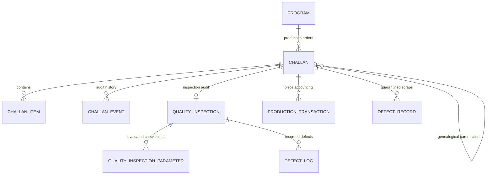

# FINAL QUALITY CONTROL (FINAL QC) DATA MODEL SPECIFICATION
## Shubham Fabrics MES | Entity Relationships & Schemas

---

## 1. REUSED PRISMA ENTITY RELATIONSHIPS

---

## 2. MODEL DETAILS

### `QualityInspection` (Inspection Header)
- `id`: UUID (Primary Key)
- `challanId`: References `Challan(id)`
- `programId`: References `Program(id)`
- `departmentCode`: `'FINAL_CHECK'`
- `inspectorId`: References `User(id)`
- `sampleSize`: Total pieces inspected in this audit session
- `status`: `'PASSED'` | `'REWORK_REQUIRED'` | `'REJECTED'` | `'ON_HOLD'`
- `notes`: Inspector summary observations
- `inspectedAt`: Timestamp of audit completion

### `QualityInspectionParameter` (Checkpoints)
- `inspectionId`: References `QualityInspection(id)`
- `parameterName`: e.g. `'Visual Appearance'`, `'Seam Strength'`, `'Measurement Chest'`, `'Zero Scorch Glaze'`
- `expectedValue`: Standard from Production Sheet
- `measuredValue`: Observed actual value
- `tolerance`: e.g. `'+/- 0.5 inch'`
- `status`: `'PASS'` | `'FAIL'` | `'OBSERVATION'`
- `comments`: Detailed checkpoint remarks

### `DefectLog` (Categorized QC Defects)
- `inspectionId`: References `QualityInspection(id)`
- `defectType`: Categorized defect name (e.g. `'Stain spot'`, `'Broken stitch'`, `'Measurement out of spec'`)
- `count`: Number of pieces affected
- `severity`: `'MINOR'` | `'MAJOR'` | `'CRITICAL'`

### `ProductionTransaction` (Quantitative Audit)
- `challanId`: References `Challan(id)`
- `programId`: References `Program(id)`
- `departmentCode`: `'FINAL_CHECK'`
- `operationName`: `'FINAL_QUALITY_INSPECTION'`
- `operatorId`: References `User(id)`
- `inputQuantity`: Total pieces presented for inspection
- `goodQuantity`: Pieces passed AQL 100% audit (Accepted)
- `reworkQuantity`: Pieces flagged for alteration / touch-up
- `rejectQuantity`: Permanent scrap / rejected pieces
- `balanceQuantity`: Remaining uninspected WIP pieces
- `unitOfMeasure`: `'PCS'`

### `DefectRecord` (Quarantined Scrap)
- `defectCode`: Unique code e.g. `DEF-FQC-YYYY-XXXX`
- `departmentCode`: `'FINAL_CHECK'`
- `itemDescription`: Garment description
- `severity`: `'CRITICAL'`
- `quantity`: Number of rejected pieces
- `status`: `'SCRAP'`
- `reason`: Primary defect cause (e.g. `'Fabric tear'`, `'Oil stain non-removable'`)

### `Challan` & Outgoing Transfer
- Sequential outgoing numbering: `CH-FQC-XXXX-XXXX`
- `fromDepartment`: `'FINAL_CHECK'`
- `toDepartment`: Dynamically resolved (`'PACKING'` by default)
- `parentChallanId`: Direct reference to the incoming Steam Press / Finishing Challan.
