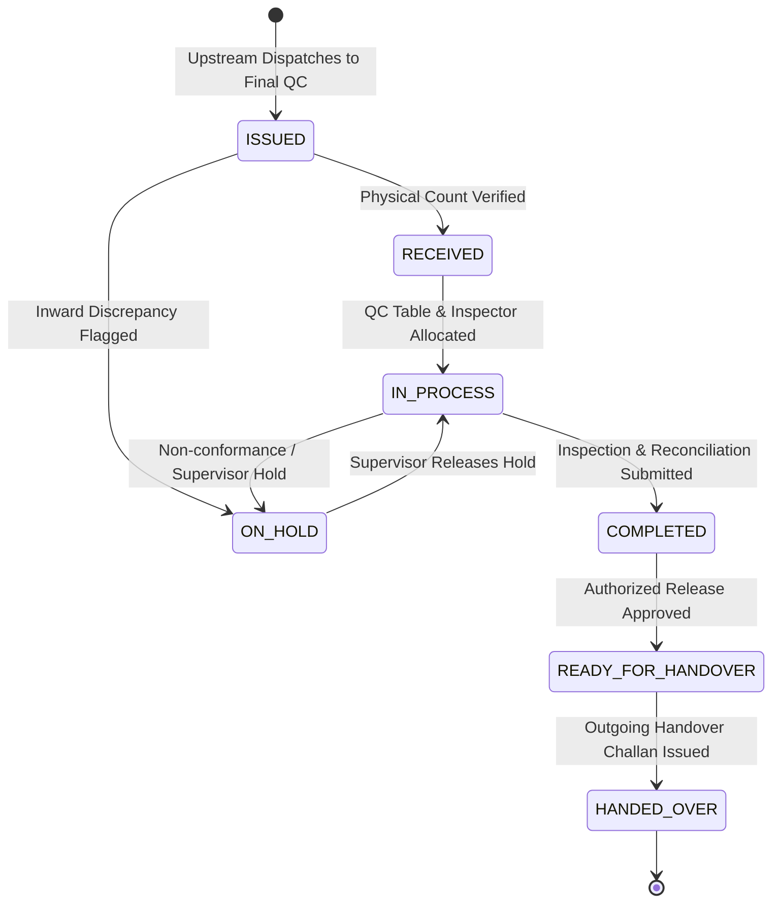

# FINAL QUALITY CONTROL (FINAL QC) STATE MACHINE
## Shubham Fabrics MES | Lifecycle and State Transitions

---

## 1. STATE DIAGRAM

---

## 2. STATE DEFINITIONS & TRANSITION RULES

| State | Definition | Permitted Next States | Guard Conditions |
| :--- | :--- | :--- | :--- |
| **`ISSUED`** | Challan created upstream addressed to `FINAL_CHECK`. | `RECEIVED`, `ON_HOLD` | Awaiting physical receipt by Final QC user. |
| **`RECEIVED`** | Physical bundle count verified on inspection floor. | `IN_PROCESS`, `ON_HOLD` | $Received \le Issued$. Discrepancies logged. |
| **`IN_PROCESS`** | Active AQL inspection in progress at QC table. | `COMPLETED`, `READY_FOR_HANDOVER`, `ON_HOLD` | Workstation assigned. Inspector logged. |
| **`ON_HOLD`** | Paused due to measurement deviation or spec clarification. | `IN_PROCESS` | Reason documented. Requires supervisor clearance. |
| **`COMPLETED`** | Pieces inspected, defects logged, quantities reconciled. | `READY_FOR_HANDOVER` | $Input = Accepted + Rework + Reject + WIP$. |
| **`READY_FOR_HANDOVER`**| Approved for downstream transfer to Packing. | `HANDED_OVER` | Only Accepted (Good) pieces eligible. |
| **`HANDED_OVER`** | Outgoing Challan issued to Packing; parent closed. | Terminal | Sequential `CH-FQC-...` generated with barcode. |

---

## 3. STRICT TRANSITION INVARIANTS

1. **No Skip-Receipt**: A Challan in `ISSUED` state cannot directly enter `IN_PROCESS` or `COMPLETED`.
2. **Reconciliation Gate**: `COMPLETED` cannot be reached if $\sum \text{Outcomes} \ne \text{Input}$.
3. **No Phantom Transfers**: `HANDED_OVER` can only be set atomically when a child Challan is successfully committed.
