# FINAL QUALITY CONTROL (FINAL QC) STATE MACHINE
## Shubham Fabrics MES | Lifecycle and State Transitions

---

## 1. STATE DIAGRAM

```mermaid
stateDiagram-v2
    [*] --> ISSUED : Upstream Dispatches to Final QC
    ISSUED --> RECEIVED : Physical Count Verified
    ISSUED --> ON_HOLD : Inward Discrepancy Flagged
    RECEIVED --> IN_PROCESS : QC Table & Inspector Allocated
    IN_PROCESS --> ON_HOLD : Non-conformance / Supervisor Hold
    ON_HOLD --> IN_PROCESS : Supervisor Releases Hold
    IN_PROCESS --> QC_APPROVED : Inspection passed
    IN_PROCESS --> QC_REJECTED : Rejected quantity recorded
    IN_PROCESS --> REWORK_REQUESTED : Rework quantity recorded
    IN_PROCESS --> ON_HOLD : Pending quantity or manual hold
    QC_APPROVED --> HANDOVER_PROCESSING : Atomic accepted-balance claim
    QC_REJECTED --> HANDOVER_PROCESSING : Accepted balance may remain
    REWORK_REQUESTED --> HANDOVER_PROCESSING : Accepted balance may remain
    HANDOVER_PROCESSING --> HANDED_OVER : Entire accepted balance transferred
    HANDOVER_PROCESSING --> QC_APPROVED : Partial transfer; prior state was QC_APPROVED
    HANDOVER_PROCESSING --> QC_REJECTED : Partial transfer; prior state was QC_REJECTED
    HANDOVER_PROCESSING --> REWORK_REQUESTED : Partial transfer; prior state was REWORK_REQUESTED
    HANDED_OVER --> [*]
```

---

## 2. STATE DEFINITIONS & TRANSITION RULES

| State | Definition | Permitted Next States | Guard Conditions |
| :--- | :--- | :--- | :--- |
| **`ISSUED`** | Challan created upstream addressed to `FINAL_CHECK`. | `RECEIVED`, `ON_HOLD` | Awaiting physical receipt by Final QC user. |
| **`RECEIVED`** | Physical bundle count verified on inspection floor. | `IN_PROCESS`, `ON_HOLD` | $Received \le Issued$. Discrepancies logged. |
| **`IN_PROCESS`** | Active quality inspection in progress at QC table. | `QC_APPROVED`, `QC_REJECTED`, `REWORK_REQUESTED`, `ON_HOLD` | Workstation assigned. Inspector identity comes from the authenticated session. |
| **`ON_HOLD`** | Paused due to measurement deviation or spec clarification. | `IN_PROCESS` | Reason documented. Requires supervisor clearance. |
| **`QC_APPROVED`** | Checkpoints passed and at least some pieces accepted. | `HANDOVER_PROCESSING`, `ON_HOLD` | Only cumulative accepted quantity is eligible for downstream transfer. |
| **`QC_REJECTED`** | Rejected pieces were recorded; accepted quantity may also remain. | `HANDOVER_PROCESSING`, `ON_HOLD` | Rejected pieces are separately tracked and cannot be transferred. |
| **`REWORK_REQUESTED`** | Rework pieces were recorded; accepted quantity may also remain. | `HANDOVER_PROCESSING`, `ON_HOLD` | No automatic rework destination is configured. |
| **`HANDOVER_PROCESSING`** | Transaction has claimed the parent during downstream transfer. | Previous result state, `HANDED_OVER` | Transient state; transaction completes or rolls back. |
| **`HANDED_OVER`** | Entire accepted balance has been transferred to the configured next department. | Terminal | Created atomically with the child Challan. |

---

## 3. STRICT TRANSITION INVARIANTS

1. **No Skip-Receipt**: A Challan in `ISSUED` state cannot directly enter `IN_PROCESS` or `COMPLETED`.
2. **Reconciliation Gate**: Inspection cannot commit if the outcomes do not total the input.
3. **Accepted-Only Transfer**: Handover cannot exceed accepted pieces minus prior normal transfers.
4. **No Phantom Transfers**: `HANDED_OVER` is set in the same transaction as child Challan creation.

`COMPLETED`, `READY_FOR_HANDOVER`, and `READY_FOR_DISPATCH` are legacy/compatibility statuses accepted by the issue-challan endpoint; new inspections use `QC_APPROVED`, `QC_REJECTED`, `REWORK_REQUESTED`, or `ON_HOLD`.
