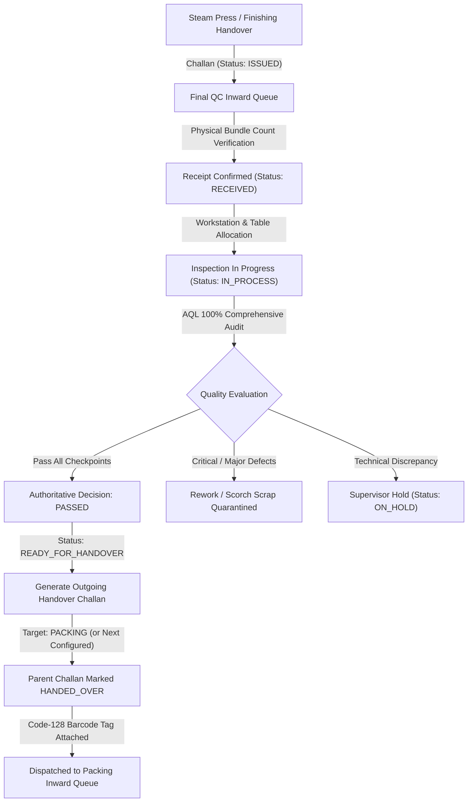

# FINAL QUALITY CONTROL (FINAL QC) WORKFLOW SPECIFICATION
## Shubham Fabrics MES | Quality Gate Architecture

---

## 1. END-TO-END WORKFLOW OVERVIEW

$$\text{Upstream (Steam Press / Finishing)} \xrightarrow{\text{Challan}} \mathbf{Final\ QC} \xrightarrow{\text{Handover Challan}} \text{Downstream (Packing / Warehouse)}$$

Final QC acts as the authoritative quality assurance gate before garments are folded, polybagged, boxed, or dispatched.

---

## 2. DETAILED STAGE SPECIFICATIONS

### Stage 1: Inward Receipt & Verification
- **Trigger**: Upstream department issues a Challan addressed to `toDepartment: 'FINAL_CHECK'`.
- **Action**: Inspector compares physical garment count against the issued Challan quantity.
- **Rule**: $Received \le Issued$. If $Received < Issued$, a shortage discrepancy note is recorded on the `ChallanEvent`.
- **Status Change**: Transitions from `ISSUED` $\rightarrow$ `RECEIVED`.

### Stage 2: Inspection Station Allocation
- **Trigger**: Inspector selects a received batch from the active queue.
- **Action**: Allocates inspection table (e.g., "QC Lightbox Table 1") and records inspector identity.
- **Status Change**: Transitions from `RECEIVED` $\rightarrow$ `IN_PROCESS`.

### Stage 3: Quality Checkpoints & Parameter Evaluation
Inspector executes comprehensive checks against the linked Production Sheet (`Program`):
1. **Visual Appearance & Workmanship**: Fabric flaws, shading variations, alignment.
2. **Embroidery & Motif Integrity**: Jump stitches, loose threads, sequin attachment, registration.
3. **Stitching & Seam Construction**: Seam slippage, skipped stitches, puckering, tension balance.
4. **Trimming & Cleanliness**: Thread tails $< 2\text{mm}$, zero oil spots, zero chalk marks.
5. **Pressing Quality & Glaze Check**: Crisp crease lines, zero scorch glaze or shine, 100% dry.
6. **Key Measurement Verification**: Chest width, body length, sleeve length within tolerance ($\pm 0.5$ inch).
7. **Trims, Buttons & Labels**: Correct washcare label, size label, brand tag placement.

### Stage 4: Output Reconciliation & Disposition
- Every single piece must be accounted for:
  $$\text{Input Pieces} = \text{Accepted Pieces} + \text{Rework Pieces} + \text{Rejected Pieces} + \text{Pending Pieces}$$
- `Accepted (Good)` $\rightarrow$ Eligible for downstream transfer.
- `Rework (Alteration)` $\rightarrow$ Logged with specific alteration reason (e.g. "Restitch hem puckering").
- `Rejected (Scrap)` $\rightarrow$ Quarantined with `DefectRecord` (status: `SCRAP`).
- If batch passes audit: Transitions to `COMPLETED` and advances to `READY_FOR_HANDOVER`.

### Stage 5: Downstream Handover to Packing
- Inspector generates an outgoing Challan with format `CH-FQC-XXXX-XXXX`.
- Dynamically resolves next destination from `STANDARD_FACTORY_ROUTE` (defaults to `PACKING`).
- Generates a Code-128 barcode sticker tag.
- Marks parent Challan as `HANDED_OVER`.
