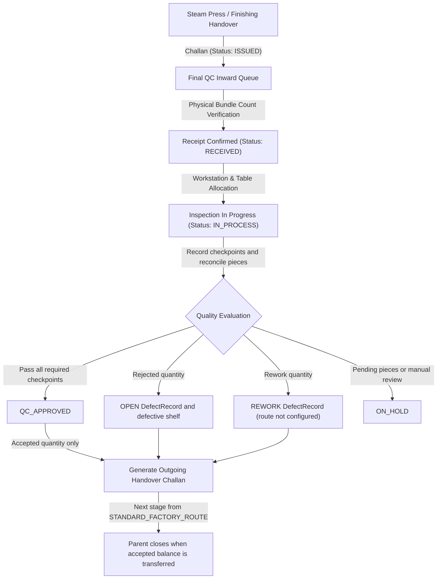

# FINAL QUALITY CONTROL (FINAL QC) WORKFLOW SPECIFICATION
## Shubham Fabrics MES | Quality Gate Architecture

---

## 1. END-TO-END WORKFLOW OVERVIEW

$$\text{Upstream (Steam Press / Finishing)} \xrightarrow{\text{Challan}} \mathbf{Final\ QC} \xrightarrow{\text{Handover Challan}} \text{Downstream (Packing / Warehouse)}$$

Final QC acts as the authoritative quality assurance gate before garments are folded, polybagged, boxed, or dispatched.

---

## 2. DETAILED STAGE SPECIFICATIONS

### Stage 1: Inward Receipt & Verification
- **Trigger**: Upstream department issues a Challan addressed to `toDepartment: 'FINAL_CHECK'`.
- **Action**: Inspector compares physical garment count against the issued Challan quantity.
- **Rule**: $0 < Received \le Issued$. If $Received < Issued$, a shortage discrepancy note is recorded on the `ChallanEvent`; the operator may explicitly place it on hold.
- **Status Change**: Conditionally transitions from `ISSUED` to `RECEIVED` (or `ON_HOLD` for an explicitly held shortage).

### Stage 2: Inspection Station Allocation
- **Trigger**: Inspector selects a received batch from the active queue.
- **Action**: Allocates inspection table (e.g., "QC Lightbox Table 1") and records inspector identity.
- **Status Change**: Transitions from `RECEIVED` $\rightarrow$ `IN_PROCESS`.

### Stage 3: Quality Checkpoints & Parameter Evaluation
Inspector records the implemented checkpoints against the linked Production Sheet (`Program`): stitching quality, measurement, appearance, labels, and packaging readiness. Checkpoint values must be `PASS` or `FAIL`; all five are required.

### Stage 4: Output Reconciliation & Disposition
- Every single piece must be accounted for:
  $$\text{Input Pieces} = \text{Accepted Pieces} + \text{Rework Pieces} + \text{Rejected Pieces} + \text{Pending Pieces}$$
- `Accepted (Good)` $\rightarrow$ Eligible for downstream transfer.
- `Rework (Alteration)` $\rightarrow$ Logged with specific alteration reason (e.g. "Restitch hem puckering").
- `Rejected` $\rightarrow$ `DefectRecord` with `OPEN` disposition and a defective-return Challan to `DEF-SHELF-FINAL-CHECK`; it is not automatically classified as scrap.
- `Rework` $\rightarrow$ a `REWORK` defect record; no automatic rework destination is configured.
- Inspection statuses are `QC_APPROVED`, `QC_REJECTED`, `REWORK_REQUESTED`, or `ON_HOLD`, according to checkpoints and dispositions.

### Stage 5: Downstream Handover to Packing
- Inspector issues an outgoing Challan with a unique `CH-FQC-...` identifier.
- Dynamically resolves the next destination from `STANDARD_FACTORY_ROUTE` (currently `PACKING`).
- Transfers only accepted quantity, minus quantities previously handed over.
- Marks the parent `HANDED_OVER` once its accepted balance is fully transferred. Code-128 barcode image generation is not currently implemented.

The browser refreshes Final QC sections by polling the database-backed endpoints; it does not use WebSockets.
