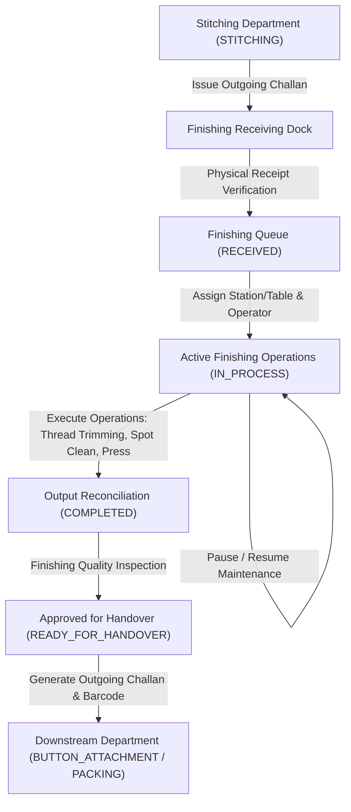

# SHUBHAM FABRICS MES — FINISHING WORKFLOW SPECIFICATION

## 1. End-to-End Workflow Stages

## 2. Granular Stage Descriptions

### Stage 1: Incoming Material Receipt
- The Finishing Department supervisor inspects incoming Challans issued by Stitching (`toDepartment: 'FINISHING'`).
- Physical verification: Bundles of assembled garments are counted and verified against the Challan quantity.
- Shortage/Discrepancy: Discrepancies are logged in remarks. If approved, status transitions to `RECEIVED`. Over-receipt is strictly rejected.

### Stage 2: Station Allocation & Operation Start
- A finishing job is allocated to a finishing station / table, iron station, or trim line.
- Assigned operator and station IDs are recorded.
- Status transitions to `IN_PROCESS`.

### Stage 3: Configurable Finishing Operations
1. **Thread Trimming & De-linting:** Removing all chain stitches, tail threads, and loose fibers.
2. **Spot Cleaning & Stain Removal:** Cleaning oil marks or process chalk.
3. **Form & Crease Pressing:** Ironing and shaping according to approved tech pack.
4. **Dimension & Measurement Verification:** Checking key size points.

### Stage 4: Output Reconciliation
- Reconciles quantities strictly:
  $$\text{Input Quantity} = \text{Good Finished Garments} + \text{Rework (Re-trim/Clean)} + \text{Reject (Scrap)} + \text{WIP / Balance}$$
- Persists an atomic `ProductionTransaction` with `departmentCode: 'FINISHING'`, `operationName: 'GARMENT_FINISHING'`.
- Quarantines damaged pieces in `DefectRecord`.

### Stage 5: Finishing Quality Inspection
- Inspects: Thread trimming cleanliness, iron shine/crease quality, stain removal, dimension conformance, and overall presentation.
- Status advances to `READY_FOR_HANDOVER`.

### Stage 6: Handover Challan Issuance
- Resolves next department from factory route (e.g. `BUTTON_ATTACHMENT` or `PACKING`).
- Preserves `parentChallanId` for complete genealogy.
- Emits Code-128 barcode sticker card.
- Parent Challan status updates to `HANDED_OVER`.
