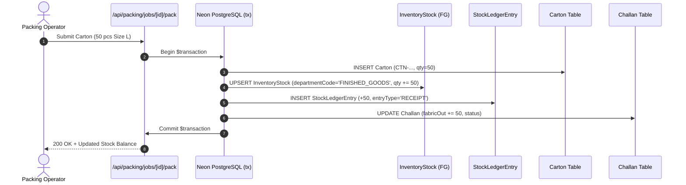

# Finished Goods Inventory Architecture

## Shubham Fabrics MES | Warehouse Stock & Valuation Ledger

---

## 1. Finished Goods Architecture

The Shubham Fabrics MES inventory engine models Finished Goods inventory through a dual-record accounting approach:
1. **Real-time Snapshot Table (`InventoryStock`)**:
   Provides $O(1)$ lookups of current on-hand pieces by department and SKU identifier.
2. **Immutable Audit Ledger Table (`StockLedgerEntry`)**:
   Provides an append-only chronological audit log of every piece increment or decrement.

---

## 2. Stock Key Derivation

SKU stock records in Finished Goods use a standardized composite identifier:
$$\text{identifier} = \text{UPPERCASE}(\texttt{"\{styleCode\}-\{size\}-\{colour\}"})$$
Examples:
- `STYLE-2026-L-NAVY`
- `SHIRT-SLIM-M-WHITE`
- `KURTI-01-FREE-SIZE-MAROON`

If colour is unspecified, it defaults to `'STANDARD'`:
- `DENIM-01-32-STANDARD`

---

## 3. Atomic Handover Sequence

When packing garments into Finished Goods:

This guarantees that:
- A carton is never created without an inventory balance update.
- Inventory is never incremented without an audit ledger entry.
- No partial writes occur if database connectivity drops.
