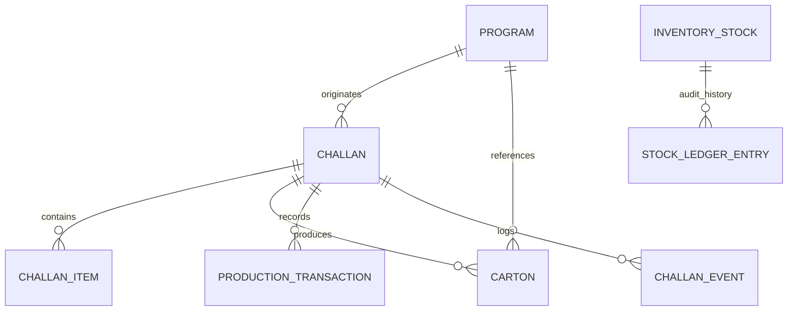

# Packing & Finished Goods Inventory — Data Model & Schema

## Shubham Fabrics MES | Entity Relationships & Storage Schema

---

## 1. Schema Entities & Domain Roles

The Packing & Finished Goods domain utilizes four primary entities existing within the Prisma schema:

### 1.1 `Carton`
Represents a physical package/box in the warehouse holding finished garments.

| Field | Type | Description |
|---|---|---|
| `id` | String (CUID) | Primary Key |
| `cartonNumber` | String (Unique) | Physical carton identifier (e.g., `CTN-CHALLAN-1`) |
| `programId` | String | Foreign key to `Program` |
| `packingChallanId` | String (Optional) | Foreign key to source `Challan` |
| `size` | String | Garment size contained (e.g., `M`, `L`, `XL`, `Free Size`) |
| `colour` | String (Optional) | Garment colour |
| `quantity` | Int | Integer count of garments packed in this carton |
| `grossWeightKg` | Float (Optional) | Total weight including box and polybags |
| `netWeightKg` | Float (Optional) | Net weight of garments |
| `dimensionsCm` | String (Optional) | Package dimensions (e.g., `60x40x30`) |
| `locationRack` | String (Optional) | Warehouse rack identifier (e.g., `FG-A1`) |
| `locationShelf` | String (Optional) | Shelf bin identifier (e.g., `S1`) |
| `barcode` | String (Optional) | Machine-readable barcode for scanning |
| `status` | String | Warehouse status (Default: `'IN_FG_STORE'`) |
| `createdAt` | DateTime | Timestamp of carton creation |

### 1.2 `InventoryStock`
Represents the real-time stock balance snapshot per SKU in a given department.

| Field | Type | Description |
|---|---|---|
| `id` | String (CUID) | Primary Key |
| `departmentCode` | String | Must be `'FINISHED_GOODS'` for FG store |
| `identifier` | String | Unique composite key `${styleCode}-${size}-${colour}` |
| `description` | String (Optional) | Human-readable SKU name |
| `currentQuantity` | Float / Int | Live available quantity |
| `uom` | String | Unit of measure (`'PCS'`) |
| `programId` | String (Optional) | Linked program |
| `lastChallanId` | String (Optional) | Last challan that mutated this stock |
| `updatedAt` | DateTime | Auto-updated timestamp |

### 1.3 `StockLedgerEntry`
Immutable audit log recording every inventory movement.

| Field | Type | Description |
|---|---|---|
| `id` | String (CUID) | Primary Key |
| `entryType` | String | Movement type: `'RECEIPT'`, `'DISPATCH'`, `'ADJUSTMENT'` |
| `departmentCode` | String | `'FINISHED_GOODS'` |
| `itemCode` | String | Stock identifier (e.g., `${styleCode}-${size}`) |
| `itemName` | String (Optional) | Item name |
| `quantity` | Float / Int | Quantity change ($+$ for receipt, $-$ for dispatch) |
| `balanceAfter` | Float / Int | Reconciled running balance after movement |
| `referenceType` | String | Origin type: `'PRODUCTION'`, `'DISPATCH'`, `'COUNT'` |
| `referenceId` | String (Optional) | Source Challan ID |
| `actorId` | String (Optional) | User who executed the transaction |
| `createdAt` | DateTime | Immutable event timestamp |

### 1.4 `ProductionTransaction`
Records the physical piece transformation on the factory floor.

| Field | Type | Description |
|---|---|---|
| `id` | String (CUID) | Primary Key |
| `departmentCode` | String | `'PACKING'` |
| `programId` | String | Production program |
| `challanId` | String | Source handover challan |
| `operatorId` | String | Packing operator |
| `inputQuantity` | Float | Pieces taken for packaging |
| `goodQuantity` | Float | Pieces packed into cartons |
| `recordedAt` | DateTime | Shift execution timestamp |
