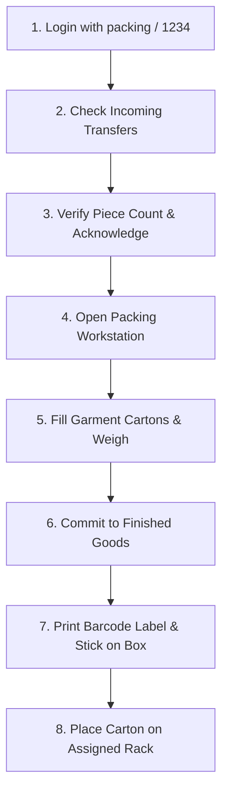

# Packing & Inventory Updation — Standard Operating Procedure (SOP)

## Shubham Fabrics MES | Floor Operations Guide

---

## 1. Quick-Start Checklist for Shift Supervisors

---

## 2. Daily Operations Procedures

### Operation A: Receiving Pieces from Final QC
1. Open the Packing Dashboard: `https://shubham-fabrics.vercel.app/packing`.
2. Click **Incoming (Final QC)** in the left sidebar or the "Awaiting Inward" card.
3. Locate the incoming Challan matching the physical garment bundle.
4. Count the physical garments received.
5. Click **Acknowledge Receipt**.
6. If the physical count matches the Challan, confirm receipt.
7. If there is a shortage or damage:
   - Enter the actual good count received.
   - Enter notes in the remarks box (e.g., "Shortage of 2 pcs from Final QC dispatch").
   - Check "Place this handover ON HOLD" if supervisor investigation is needed.

### Operation B: Packing Cartons on the Floor
1. Go to **Packing Workstation** (`/packing/workspace`).
2. Select the ready production job.
3. In the packing form:
   - Select the garment **Size** (e.g., `M`, `L`, `XL`).
   - Enter the **Quantity** of pieces placed in this carton (must not exceed remaining balance).
   - Enter the **Gross Weight** (kg) from the floor weighing scale.
   - Enter the target warehouse **Rack** (e.g., `FG-A1`) and **Shelf** (e.g., `S1`).
4. Click **Create Carton & Post to FG Stock**.
5. The system saves the carton, increases Finished Goods stock, and records an immutable audit ledger entry.

### Operation C: Printing & Applying Carton Labels
1. After creating the carton, it appears in the **Cartons Created** table on the right.
2. Click the **Label** button next to the carton.
3. Review the barcode sticker modal containing:
   - Shubham Fabrics logo
   - Carton Number (e.g., `CTN-CH-1234-1`)
   - Program Number & Style Code
   - Buyer / Client Name
   - Size, Colour & Net Piece Count
   - Warehouse Rack & Shelf coordinates
   - Machine-scannable Barcode
4. Click **Print Label** to send to the thermal label printer.
5. Affix the printed label firmly to the side of the physical corrugated box.

### Operation D: Handover Completion
- When all received pieces have been packed, the remaining counter reaches 0.
- The system automatically marks the source Challan as `COMPLETED`.
- All boxed inventory is immediately visible in the **Finished Goods Store** (`/packing/inventory`) for subsequent dispatch.
