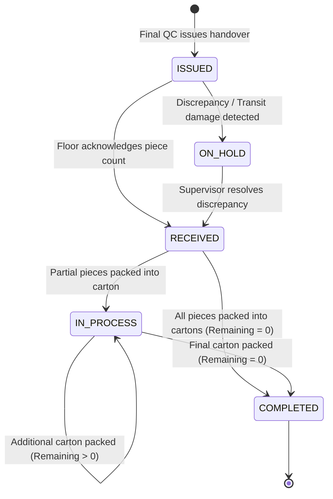
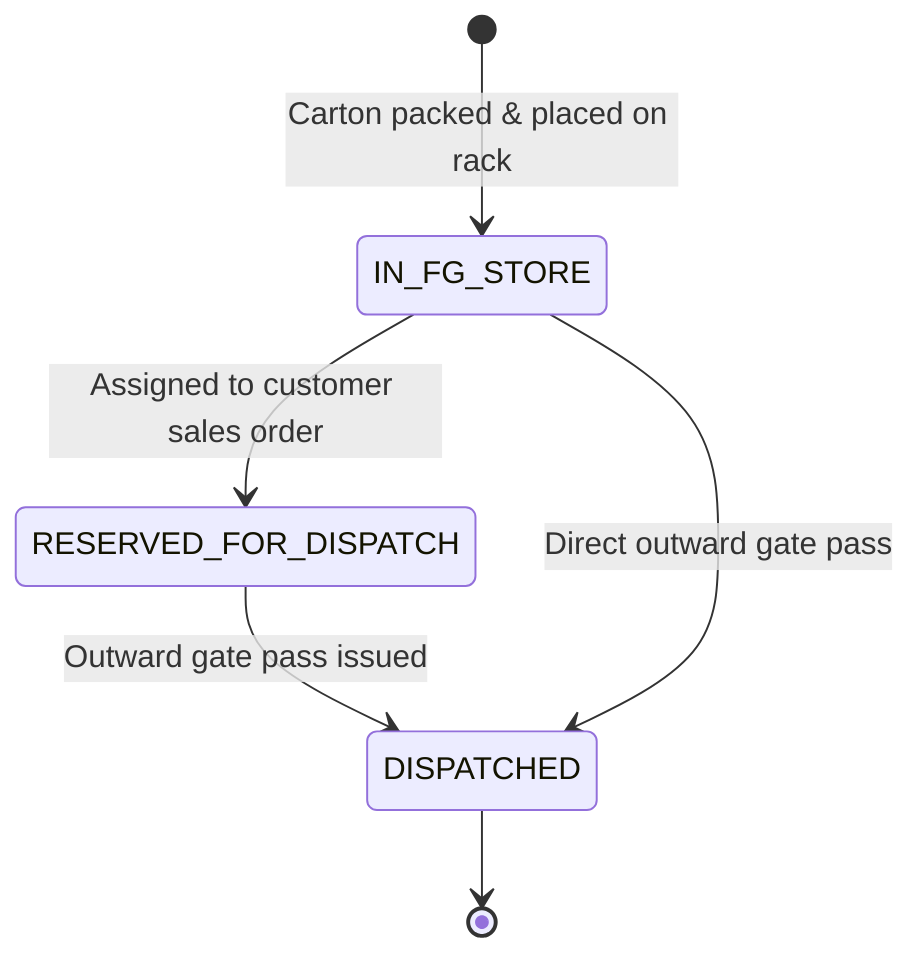

# Packing Department — State Machine & Lifecycle Transitions

## Shubham Fabrics MES | Challan & Carton Lifecycle

---

## 1. Handover Challan State Transitions

A Challan directed to the Packing Department undergoes the following strict lifecycle:

### Transition Matrix

| Current State | Event Trigger | Next State | Allowed Actor | Validation Checks |
|---|---|---|---|---|
| `ISSUED` | `RECEIVE_CHALLAN` | `RECEIVED` | Packing Supervisor / Admin | Received count must be positive integer |
| `ISSUED` | `RECEIVE_CHALLAN (markOnHold=true)` | `ON_HOLD` | Packing Supervisor / Admin | Discrepancy remarks required |
| `ON_HOLD` | `RELEASE_HOLD` | `RECEIVED` | Packing Supervisor / Admin | Supervisor sign-off required |
| `RECEIVED` | `PACK_CARTON (Remaining > 0)` | `IN_PROCESS` | Packing Operator | Packed count $\le$ Remaining count |
| `RECEIVED` | `PACK_CARTON (Remaining = 0)` | `COMPLETED` | Packing Operator | Entire received batch boxed |
| `IN_PROCESS` | `PACK_CARTON (Remaining > 0)` | `IN_PROCESS` | Packing Operator | Cumulative count bounded by received count |
| `IN_PROCESS` | `PACK_CARTON (Remaining = 0)` | `COMPLETED` | Packing Operator | All pieces accounted for in cartons |

---

## 2. Carton State Lifecycle

Physical Cartons follow this lifecycle:

### Carton Invariants
1. `cartonNumber` is unique across the entire application lifecycle (`CTN-...`).
2. Each carton belongs to exactly one `Program` and optionally one source `Challan`.
3. Carton piece quantity must be a strictly positive whole number.
4. Carton status defaults to `'IN_FG_STORE'` upon packing completion.
