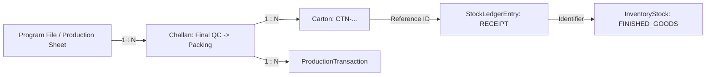

# Packing & Finished Goods Traceability Specification

## Shubham Fabrics MES | Complete Forward & Backward Genealogies

---

## 1. Traceability Mission

At any point in time, a warehouse supervisor or client auditor must be able to inspect a physical carton on a warehouse shelf and trace:
1. Which **Program** and **Production Sheet** specified the order.
2. Which **Final QC Inspector** approved the pieces.
3. Which **Challan** delivered the pieces to Packing.
4. Which **Packing Operator** packed the carton.
5. Exactly when and where the Finished Goods inventory balance was incremented.

Conversely, looking up an original Program must list every single carton packed and currently sitting in Finished Goods storage.

---

## 2. Relational Linkage Model

### Traceability Attributes Stored on `Carton`:
- `programId`: Direct foreign key to `Program`.
- `packingChallanId`: Direct foreign key to source handover `Challan`.
- `cartonNumber`: Unique identifier, also encoded as barcode string.
- `locationRack` & `locationShelf`: Physical warehouse coordinates.
- `createdAt`: ISO 8601 creation timestamp.

---

## 3. Forward & Backward Audit Verification

### Backward Trace (From Warehouse Carton):
1. Scan carton barcode `CTN-CH-FN-1718-ABC123-1`.
2. Query `Carton` table &rarr; finds `programId` and `packingChallanId`.
3. Query `Challan` table &rarr; displays Final QC inspection remarks, issued date, and inspector name.
4. Query `Program` table &rarr; displays tech pack, client name, fabric roll numbers, Wilcom embroidery design, and stitch counts.

### Forward Trace (From Production Sheet):
1. User views `/programs/[id]`.
2. Queries all `Carton` records matching `programId`.
3. Displays total cartons packed, carton barcodes, current warehouse locations, and date packed.
