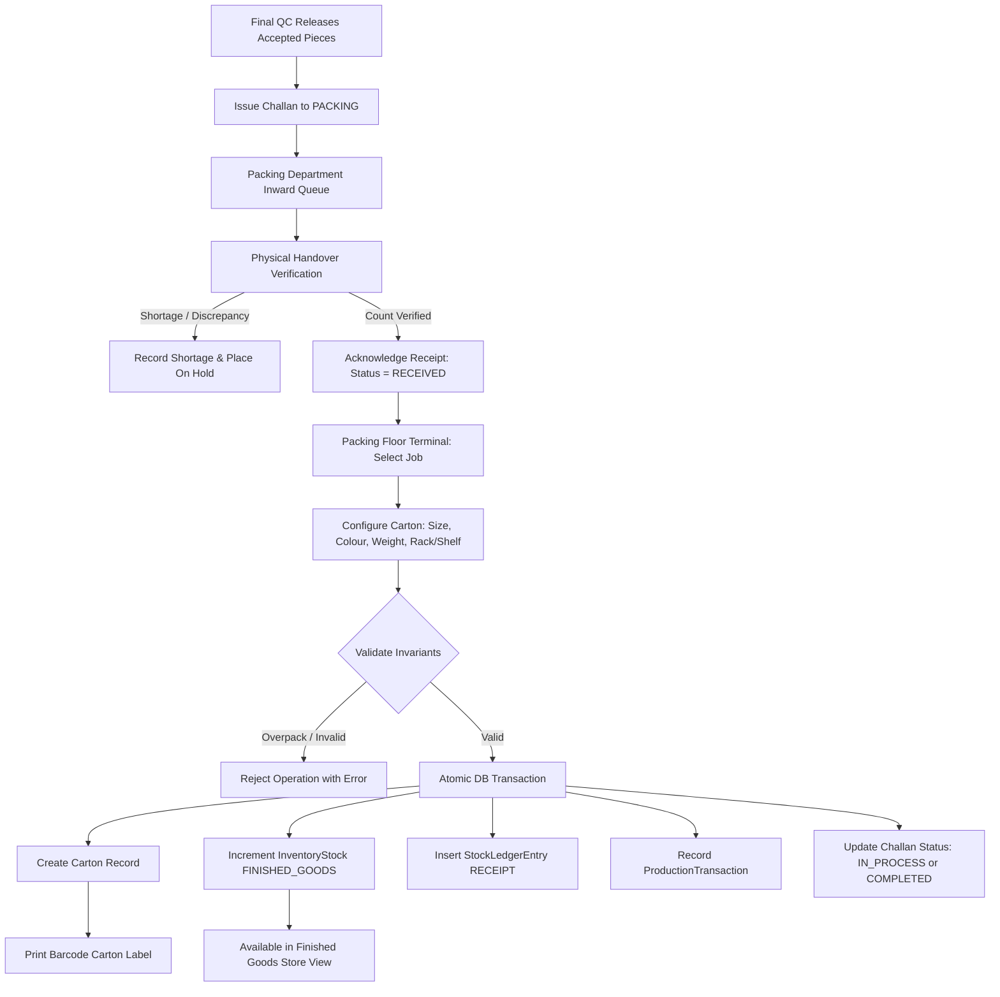

# Packing & Inventory Updation — Business Workflow Specification

## Shubham Fabrics MES | Production Handover & Finished Goods Stock

---

## 1. Domain Overview & Boundary

The **Packing & Inventory Updation Department** is Department 15 in the authoritative factory route:
$$\text{Finishing} \rightarrow \text{Steam Press} \rightarrow \text{Final QC} \rightarrow \mathbf{Packing} \rightarrow \text{Finished Goods} \rightarrow \text{Dispatch}$$

It serves as the bridge between production processing and warehouse fulfillment:
- **Upstream Input**: Quality-approved garments received from Final QC via official Challan accompanied by the original Production Sheet.
- **Internal Floor Operations**: Physical piece count verification, barcode label assignment, polybagging, carton packaging, and gross/net weight measurement.
- **Downstream Output**: Packaged physical `Carton`s placed on warehouse racks/shelves with atomic updates to the authoritative Finished Goods inventory ledger (`InventoryStock` + `StockLedgerEntry`).
- **Domain Boundaries**: Customer dispatch, outward shipping, logistics, and invoicing are downstream operations. Packing does NOT trigger customer dispatch.

---

## 2. End-to-End Operational Workflow

### Step 1: Challan Generation by Final QC
- Final QC completes visual, dimensional, and aesthetic inspections.
- Accepted garments are batched and issued via a Challan addressed to `toDepartment: 'PACKING'`.
- Status is set to `ISSUED`.

### Step 2: Physical Receipt Acknowledgment
- The Packing Supervisor inspects the incoming physical bundle on arrival.
- The supervisor opens `/packing/incoming` and clicks "Acknowledge Receipt".
- The actual piece count received is verified against the sender's declared count.
- If physical count matches, the challan status transitions to `RECEIVED`.
- If discrepancies, stains, or damages are found, the supervisor records remarks and can mark the handover `ON_HOLD`.

### Step 3: Carton Packaging & Barcode Generation
- In the Packing Workstation (`/packing/workspace/[id]`), the operator selects the received job.
- For each carton packed:
  1. Select garment size and colour.
  2. Enter the piece quantity for this specific carton.
  3. Optional: enter gross weight (kg), net weight (kg), rack (e.g., `FG-A1`), and shelf (e.g., `S1`).
  4. Click "Create Carton & Post to FG Stock".

### Step 4: Authoritative Inventory Ledger Posting
- In a single atomic database transaction:
  - Creates the physical `Carton` record with unique carton number (`CTN-...`).
  - Upserts the `InventoryStock` balance for `departmentCode = 'FINISHED_GOODS'` and identifier `${styleCode}-${size}-${colour}`.
  - Inserts an immutable `StockLedgerEntry` recording `+packedQuantity` with balance after.
  - Records a `ProductionTransaction` capturing operator throughput.
  - Updates the source Challan's packed total (`fabricOut`).
  - When remaining pieces reach 0, transitions Challan status to `COMPLETED`.

---

## 3. Discrepancy & Shortage Handling

1. **Shortage on Arrival**:
   - If Final QC dispatched 100 pcs but only 98 pcs are physically received, the operator records `receivedQuantity: 98`.
   - The system logs a `ChallanEvent` highlighting the 2-piece transit shortage.
   - The packing floor is bounded strictly by the 98 verified pieces — the operator cannot pack 100 pieces.

2. **Floor Damage During Packing**:
   - If garments are torn or soiled during packaging, they are flagged as defects.
   - Under-packed challans can remain in `IN_PROCESS` or be closed with supervisor notes.

3. **Double-Counting Guard**:
   - Re-packing the same carton or exceeding the verified piece count is mathematically rejected server-side ($Remaining = Received - Packed$).
