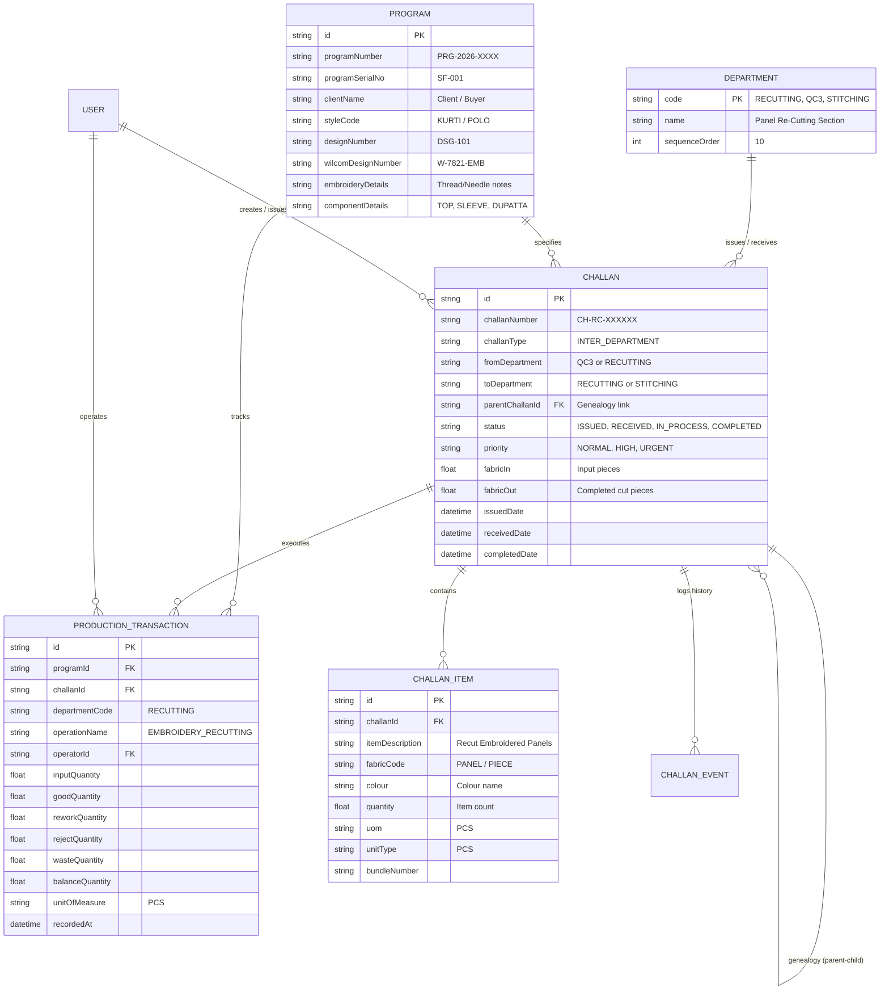

# Data Model & Entity Specifications: Recutting Department

**Document Version:** 1.0.0  
**Department:** Panel & Embroidery Recutting Section (`RECUTTING`)  
**Database:** PostgreSQL (Neon Cloud) via Prisma ORM  

---

## 1. Domain Entities & Relationships

The Recutting department leverages the core domain models of the Shubham Fabrics MES without creating disconnected shadow tables.

---

## 2. Field Specifications for Recutting Operations

### 2.1 Outgoing Challan Creation Payload (`CH-RC-...`)
When issuing material from Recutting to Stitching:
- `challanNumber`: System-generated sequential identifier (e.g. `CH-RC-104921`).
- `challanType`: `'INTER_DEPARTMENT'`.
- `fromDepartment`: `'RECUTTING'`.
- `toDepartment`: `'STITCHING'`.
- `parentChallanId`: Mandatory foreign key referencing the incoming QC Washing challan.
- `programId`: Inherited from the incoming lot's linked Production Sheet.
- `status`: `'ISSUED'`.
- `priority`: Inherited or elevated (`'NORMAL'`, `'HIGH'`, `'URGENT'`).
- `items`: List of cut components with:
  - `itemDescription`: Detailed panel description (e.g., `"Front Embroidered Cut Panels - Ready for Stitching"`).
  - `fabricCode`: Piece/Component identifier.
  - `colour`: Matched with production sheet specifications.
  - `quantity`: Exact verified count of good cut pieces.
  - `uom`: `'PCS'`.
  - `unitType`: `'PCS'`.
  - `remarks`: Inspection clearance notes.

### 2.2 Production Transaction Schema
For every batch cut:
- `operationName`: `'EMBROIDERY_RECUTTING'`.
- `departmentCode`: `'RECUTTING'`.
- `inputQuantity`: Number of washed embroidered pieces taken for cutting.
- `goodQuantity`: Number of accurately dimensioned panels produced.
- `reworkQuantity`: Number of panels requiring edge re-trimming.
- `rejectQuantity`: Scrapped panels damaged by miss-cuts.
- `wasteQuantity`: Trim margin shavings.
- `balanceQuantity`: Remaining uncut panels.
- `unitOfMeasure`: `'PCS'`.
- `notes`: Specific cutting table, blade, or Wilcom layout notations.

---

## 3. Data Integrity & Invariants

1. **Genealogy Invariant**: Every outgoing Challan from Recutting must have a non-null `parentChallanId` referencing a verified `QC3` challan.
2. **Quantity Conservation Invariant**:
   $$\text{Output Good Quantity} + \text{Rework Quantity} + \text{Reject Quantity} + \text{Balance} = \text{Input Quantity}$$
3. **No Over-Issuance**:
   $$\sum \text{Issued To Stitching} \le \text{Total Verified Good Recut Output}$$
4. **Program Consistency**: All child challans, items, and production transactions must reference the identical `programId` of the parent Production Sheet.
