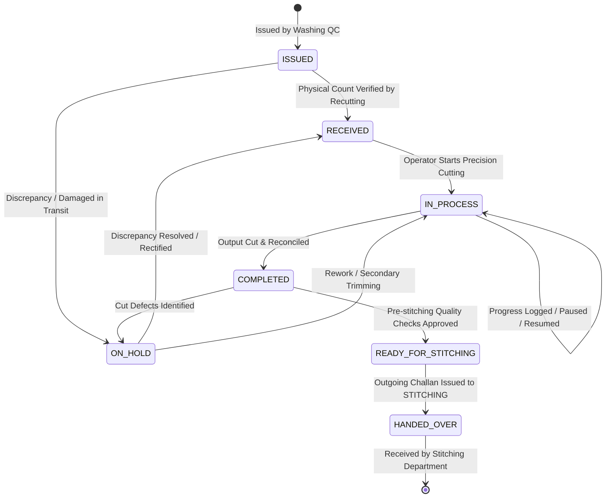

# State Machine & Status Transitions: Recutting Department

**Document Version:** 1.0.0  
**Department:** Panel & Embroidery Recutting Section (`RECUTTING`)  

---

## 1. Lifecycle State Machine Diagram

---

## 2. Transition Guard Rules & Validation

| Current State | Target State | Triggering Action | Guard Conditions & Business Rules |
| :--- | :--- | :--- | :--- |
| `ISSUED` | `RECEIVED` | `POST /receive` | 1. Caller belongs to `RECUTTING` or `ADMIN`. 2. `toDepartment` must match `RECUTTING`. 3. `receivedQuantity` must be $> 0$ and $\le$ issued item quantity. 4. Linked `Program` exists and is active. |
| `ISSUED` | `ON_HOLD` | `POST /receive` (with hold flag) | Transit damage or total piece count shortage detected. Notes required. |
| `RECEIVED` | `IN_PROCESS` | `POST /jobs/:id/start` | 1. Status is exactly `RECEIVED`. 2. Operator must be authenticated. 3. Valid cutting specifications present in Production Sheet. |
| `IN_PROCESS` | `COMPLETED` | `POST /jobs/:id/complete` | 1. Server validates $\text{Good} + \text{Rework} + \text{Reject} + \text{Balance} = \text{Input}$. 2. Good quantity cannot exceed input. 3. Atomic `ProductionTransaction` write. |
| `COMPLETED` | `READY_FOR_STITCHING` | `POST /jobs/:id/verify` | 1. Seam allowances, notches, and motif alignment checked. 2. Verified by authorized Supervisor or Inspector. |
| `READY_FOR_STITCHING` | `HANDED_OVER` | `POST /issue-challan` | 1. Outgoing Challan created with `toDepartment = 'STITCHING'`. 2. Issued quantity $\le$ verified good quantity. 3. Barcode and bundle labels generated. |
