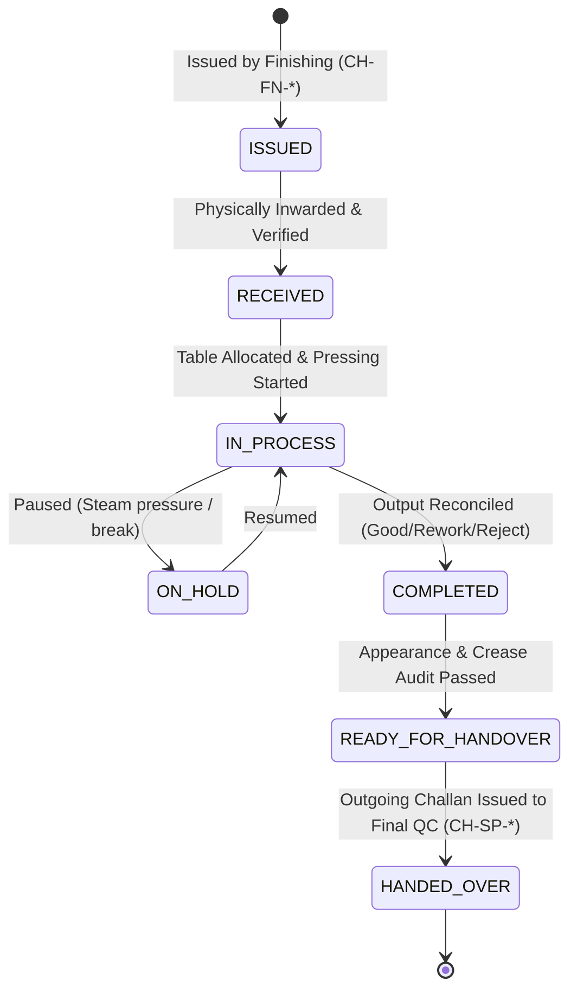

# STEAM PRESS STATE MACHINE & LIFECYCLE
## Shubham Fabrics MES

### 1. State Transitions

### 2. Guard Rules
- **Receipt Guard**: Only Challans where `toDepartment` is `STEAM_PRESS` and status is `ISSUED` can be inwarded.
- **Over-Receipt Guard**: `receivedQuantity` cannot exceed `issuedQuantity`.
- **Start Guard**: Job must be in `RECEIVED` or `ON_HOLD` status.
- **Completion Guard**: Strict reconciliation: $Input = Good + Rework + Reject + Balance$.
- **Handover Guard**: Outgoing quantity cannot exceed available unissued good balance.
