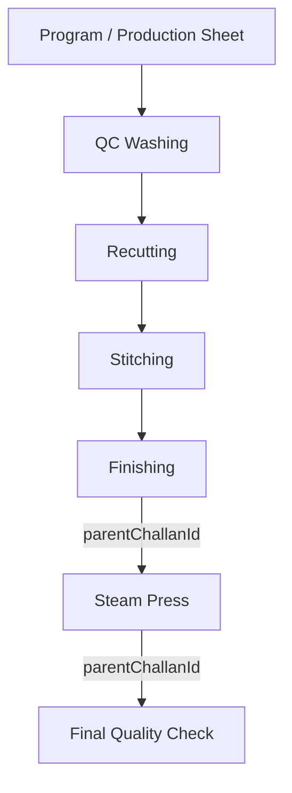

# STEAM PRESS PRODUCTION TRACEABILITY & GENEALOGY
## Shubham Fabrics MES

### 1. Complete Genealogy Chain

### 2. Genealogical Links
- The root `programId` is preserved throughout all Challans.
- Steam Press stores `parentChallanId` referencing the incoming Finishing Challan.
- The outgoing Challan to Final QC stores `parentChallanId` referencing the Steam Press Challan.
- Code-128 Barcodes (`BC-SP-XXXXXX`) attach to each dispatched bundle.
