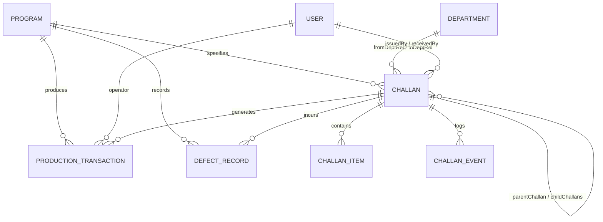

# Data Model & Schema Relationships: Stitching Department

**Document Version:** 1.0.0  
**Department:** Garment Assembly & Stitching Section (`STITCHING`)  

---

## 1. Entity-Relationship Diagram

---

## 2. Model Mapping & Constraints

### 2.1 `Challan` (Transfer Document)
- **`challanNumber`**: Unique sequential alphanumeric identifier (e.g. `CH-STC-2026-0001`).
- **`fromDepartment`**: Department code of issuing station (e.g. `RECUTTING` for incoming, `STITCHING` for outgoing).
- **`toDepartment`**: Destination department (e.g. `STITCHING` for incoming, `FINISHING` or configured next department for outgoing).
- **`parentChallanId`**: Foreign key to predecessor `Challan` preserving traceability.
- **`status`**: String enum (`ISSUED`, `RECEIVED`, `IN_PROCESS`, `COMPLETED`, `READY_FOR_HANDOVER`, `HANDED_OVER`, `ON_HOLD`).
- **`fabricIn`**: Total cut pieces/panels received into Stitching.
- **`fabricOut`**: Total finished assembled garments approved out of Stitching.

### 2.2 `ProductionTransaction` (Operation Ledger)
- **`departmentCode`**: `'STITCHING'`.
- **`operationName`**: `'GARMENT_STITCHING'`.
- **`inputQuantity`**: Number of cut panels/components consumed.
- **`goodQuantity`**: Number of finished garments assembled in good quality.
- **`reworkQuantity`**: Number of garments needing re-stitch or seam repair.
- **`rejectQuantity`**: Number of garments scrapped due to machine tear, cut damage, or fabric flaw.
- **`wasteQuantity`**: `0` (piece-based accounting).
- **`unitOfMeasure`**: `'PCS'`.
- **`operatorId`**: User identifier of the stitching operator.
- **`recordedAt`**: Timestamp of operation log.

### 2.3 `DefectRecord` (Quality Exception Log)
- **`defectCode`**: Standard stitching defect code (e.g. `SEAM_SLIPPAGE`, `NEEDLE_HOLE_DAMAGE`, `TENSION_PUCKERING`, `SKIPPED_STITCHES`, `ASYMMETRIC_ASSEMBLY`).
- **`departmentCode`**: `'STITCHING'`.
- **`severity`**: `'MINOR'`, `'MAJOR'`, `'CRITICAL'`.
- **`quantity`**: Count of rejected garments.
- **`detectedById`**: User identifier of the inspector/operator.
- **`status`**: `'OPEN'` or `'RESOLVED'`.

### 2.4 `ChallanEvent` (Immutable Audit Trail)
- **`action`**: Audit action string (e.g. `CHALLAN_RECEIVED`, `PRODUCTION_STARTED`, `PRODUCTION_PAUSED`, `PRODUCTION_RESUMED`, `PRODUCTION_COMPLETED`, `QC_INSPECTED`, `CHALLAN_ISSUED`).
- **`fromStatus`** / **`toStatus`**: State machine boundary markers.
- **`actorId`**: User identifier executing the transition.
- **`notes`**: Reason or contextual remarks.
