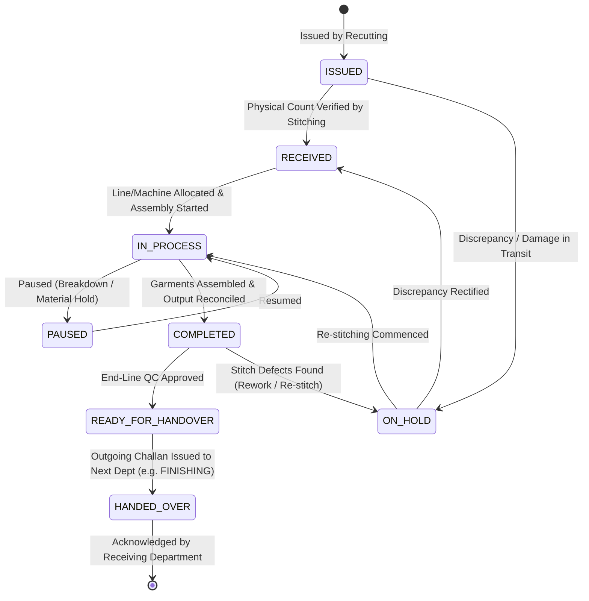

# State Machine & Status Transitions: Stitching Department

**Document Version:** 1.0.0  
**Department:** Garment Assembly & Stitching (`STITCHING`)  

---

## 1. Lifecycle State Machine Diagram

---

## 2. Transition Guard Rules & Validation

| Current State | Target State | Triggering Action | Guard Conditions & Business Rules |
| :--- | :--- | :--- | :--- |
| `ISSUED` | `RECEIVED` | `POST /receive` | 1. Caller belongs to `STITCHING` or `ADMIN`. 2. `toDepartment` must match `STITCHING`. 3. `receivedQuantity` must be $> 0$ and $\le$ issued quantity. 4. Linked `Program` exists and is active. |
| `ISSUED` | `ON_HOLD` | `POST /receive` (with hold flag) | Missing components or transit damage detected. Notes required. |
| `RECEIVED` | `IN_PROCESS` | `POST /jobs/:id/start` | 1. Status is `RECEIVED`. 2. Line, machine, or operator specified. 3. Tech sheet specs confirmed. |
| `IN_PROCESS` | `PAUSED` | `POST /jobs/:id/pause` | Pause reason string must be supplied (e.g. needle break, thread spool run-out). |
| `PAUSED` | `IN_PROCESS` | `POST /jobs/:id/resume` | Status was `PAUSED`. |
| `IN_PROCESS` | `COMPLETED` | `POST /jobs/:id/complete` | 1. Server validates $\text{Good} + \text{Rework} + \text{Reject} + \text{Balance} = \text{Input}$. 2. Good quantity cannot exceed input. 3. Atomic `ProductionTransaction` write (`operationName: 'GARMENT_STITCHING'`). |
| `COMPLETED` | `READY_FOR_HANDOVER` | `POST /jobs/:id/inspect` | 1. Seam strength, SPI, thread tension, and symmetry checked. 2. Decision = `APPROVED`. |
| `COMPLETED` | `ON_HOLD` | `POST /jobs/:id/inspect` | Decision = `HOLD` or `REWORK`. Re-stitching required. |
| `READY_FOR_HANDOVER` | `HANDED_OVER` | `POST /issue-challan` | 1. Outgoing Challan created with `toDepartment` set to next department. 2. Issued quantity $\le$ verified good balance. 3. Parent Challan updated to `HANDED_OVER`. |
