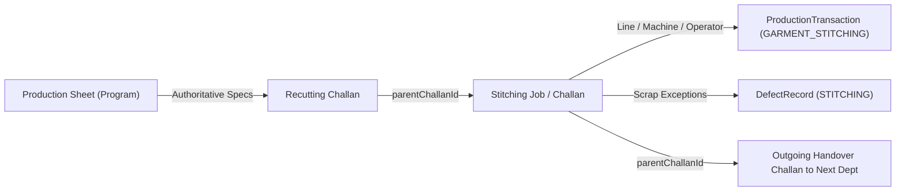

# End-to-End Traceability & Genealogy: Stitching Department

**Document Version:** 1.0.0  
**Department:** Stitching Section (`STITCHING`)  

---

## 1. Upstream & Downstream Genealogy Chain

---

## 2. Traceability Guarantees

1. **Parent-Child Linkage**:
   Every outgoing Challan created by Stitching sets `parentChallanId` to the incoming Stitching Challan's ID.
2. **Production Order Fidelity**:
   Every transaction, inspection, defect, and Challan carries `programId`, ensuring direct relationship to customer, buyer, design number, and Wilcom technical file.
3. **Machine & Line Auditing**:
   Every stitching operation records the assigned line, machine number, operator identity, and timestamps in `ChallanEvent` and `ProductionTransaction`.
4. **Barcode Encoding**:
   Outgoing bundle stickers encode Code-128 barcodes linking Challan Number, Program Number, Design Number, and piece quantities.
