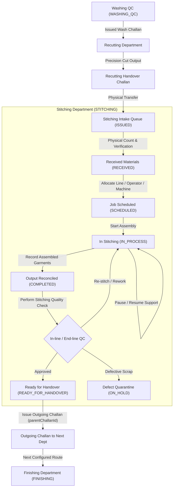

# Operational Workflow: Stitching Department

**Document Version:** 1.0.0  
**Department:** Garment Assembly & Stitching (`STITCHING`)  
**Pipeline Sequence:** $\text{Washing QC} \longrightarrow \text{Recutting (RECUTTING)} \longrightarrow \text{Stitching (STITCHING)} \longrightarrow \text{Finishing (FINISHING)}$  

---

## 1. Process Flowchart

---

## 2. Step-by-Step Operating Workflow

### Step 1: Material Receipt & Intake Verification
1. Stitching operator navigates to `/stitching/incoming`.
2. Inspects pending Challans issued by Recutting (`toDepartment = 'STITCHING'`).
3. Checks linked Production Sheet (`Program`): style, design number, Wilcom embroidery design, color, size, and components.
4. Performs physical piece count and validates condition of cut panels.
5. Confirms receipt via `POST /api/stitching/challans/:id/receive`:
   - Enforces $0 < \text{Received Quantity} \le \text{Issued Quantity}$.
   - Updates Challan status to `RECEIVED` and logs audit event in `ChallanEvent`.

### Step 2: Planning & Resource Allocation
1. Supervisor or operator opens job in `/stitching/my-work`.
2. Allocates production resources:
   - Line Number (e.g. Line 1, Line 2, Line 3).
   - Machine Number / Type (Single Needle Lockstitch, Overlock, Flatlock, Kansai).
   - Assigned Operator.
3. Clicks "Start Stitching Operation" (`POST /api/stitching/jobs/:id/start`):
   - Transitions status to `IN_PROCESS`.

### Step 3: Garment Assembly & Execution
1. Operator inspects Production Sheet tech specs and Wilcom alignment instructions.
2. Sews front and back panels, attaches sleeves/borders/collars per technical specification.
3. Supports runtime operations:
   - **Pause Job**: Reason logged (e.g. Needle Breakage, Thread Tension Adjustment, Machine Maintenance).
   - **Resume Job**: Operation resumed with timestamp logged.

### Step 4: Output Reconciliation & Scrap Accounting
1. Upon finishing stitching, operator records output via `POST /api/stitching/jobs/:id/complete`.
2. Validates mathematical reconciliation:
   $$\text{Input Pieces} = \text{Good Finished Garments} + \text{Rework (Re-stitch)} + \text{Reject (Scrap)} + \text{Balance (WIP)}$$
3. Records atomic `ProductionTransaction`:
   - `departmentCode: 'STITCHING'`
   - `operationName: 'GARMENT_STITCHING'`
   - `inputQuantity`, `goodQuantity`, `reworkQuantity`, `rejectQuantity`.
4. If `rejectQuantity > 0`, records `DefectRecord` with classification (e.g. `SEAM_SLIPPAGE`, `NEEDLE_HOLE_DAMAGE`, `TENSION_PUCKERING`, `SKIPPED_STITCHES`).
5. Status transitions to `COMPLETED`.

### Step 5: In-Line / End-Line Stitching QC Verification
1. Quality Inspector or Supervisor reviews assembled garments:
   - Seam strength & stitch density (SPI).
   - Thread tension & color matching.
   - Dimensional sizing fit against spec chart.
   - Symmetrical motif positioning and embroidery placement.
2. Submits inspection via `POST /api/stitching/jobs/:id/inspect`:
   - Decision `APPROVED`: status transitions to `READY_FOR_HANDOVER`.
   - Decision `REWORK`: flagged for re-stitch.

### Step 6: Handover to Next Configured Department
1. Operator navigates to `/stitching/issue-challan`.
2. Selects source Stitching job (unissued good balance calculated automatically).
3. Next destination resolved dynamically from factory routing (`toDepartment: 'FINISHING'` or configured alternative).
4. Specifies bundle details and instructions.
5. Issues outgoing Challan (`POST /api/stitching/issue-challan`):
   - Links `parentChallanId` to preserve genealogy.
   - Generates Code-128 barcode bundle sticker.
   - Transitions parent Challan status to `HANDED_OVER`.
