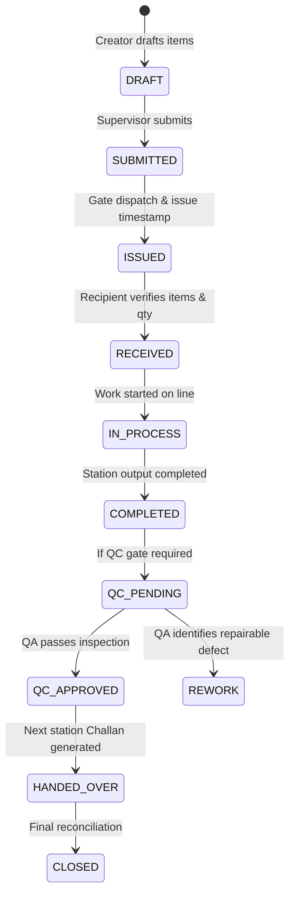

# Standard Operating Procedure (SOP-02)
## Inter-Departmental Challan Handoff & Genealogy Lifecycle

### 1. Purpose
To ensure zero unaccounted inventory between factory stations. Every physical movement of materials must be accompanied by an electronic Challan signed by both dispatching and receiving supervisors.

### 2. Challan Lifecycle States

### 3. Traceability Chain
Every Challan record stores:
- `programId`: The overarching manufacturing order.
- `parentChallanId`: Direct antecedent handoff document.
- `sourceLotId` / `sourceRollId` / `sourceBundleId`: Piece-level backward genealogy.

### 4. Fabric Store Stock Accounting
- Inward receipts are added to Total Stock by fabric, DYED/UNDYED type, and MTR/PCS unit.
- A challan dispatched **from the Fabric Store** reduces the matching in-store balance by its issued item quantity. Challans handed off between downstream departments are not counted as additional Fabric Store dispatches.
- Outward challan details are matched to inward records by fabric, type, and unit. Bill and supplier details are shown only when a matching inward record is found.
